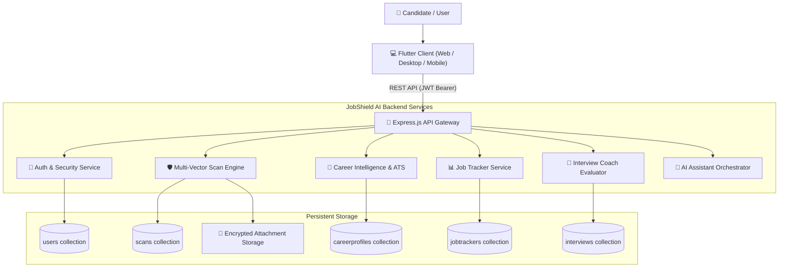

# JobShield AI – AI-Powered Career Intelligence, Recruitment Fraud Detection & Candidate Safety Platform

[](https://flutter.dev)
[](https://nodejs.org)
[](https://expressjs.com)
[](https://www.mongodb.com)
[](LICENSE)

JobShield AI is a comprehensive enterprise-grade candidate safety and career intelligence ecosystem. Designed to combat the surging wave of predatory job scams, fake recruiters, impersonation attacks, and phantom job listings, JobShield AI pairs deep multi-vector risk analysis with full-suite career empowerment tools (ATS resume analysis, job matching, LinkedIn optimization, cover letter generation, Kanban job tracking, and an interactive interview coach).

---

## 1. Project Overview

Modern recruitment fraud has evolved far beyond suspicious emails—scammers now clone legitimate corporate domains, establish fake personas on Telegram/WhatsApp, and charge advance registration fees or distribute malicious checks. 

**JobShield AI** provides job seekers with a verified defense barrier:
- **Instant Fraud Detection:** Analyzes job URLs, job descriptions, screenshots, PDF offer letters, and recruiter communication patterns.
- **5-Tier Risk Classification:** Transparently categorizes offers into `SAFE`, `LOW RISK`, `SUSPICIOUS`, `HIGH RISK`, or `SCAM` with verifiable evidence and safety steps.
- **Unified Career Suite:** Helps candidates safely build their applications through an ATS scanner, job matcher, and interview coach with exact 5-question core preparation.

---

## 2. Main Features

### 🛡️ Candidate Safety & Fraud Detection
- **Multi-Vector Job Scanner:** Evaluates job offerings through 5 independent vectors:
  - **URL & Domain Analysis:** TLD reputation check, IP address detection, punycode/homoglyph verification, and domain matching.
  - **Company & Impersonation Check:** Detects recruiters posing as Fortune 500 employers using free webmail (`@gmail.com`, `@yahoo.com`).
  - **Recruiter & Platform Analysis:** Flags unauthorized recruitment exclusively conducted over anonymous messaging channels (Telegram, WhatsApp, Signal).
  - **Financial Risk & Advance-Fee Fraud:** Identifies equipment fee demands, fake check reimbursements, crypto/cash app deposits, and background-check charges.
  - **Urgency & Coercion Detection:** Spots high-pressure psychological manipulation ("immediate start", "no interview needed").
- **Screenshot & Document OCR Analysis:** Extracts and evaluates job offers from uploaded images, PDFs, and message screenshots.
- **Real-Time Security Scoring:** Dynamic user safety rating based on scan history and scam exposure.
- **Scam Report Community Registry:** Enables candidates to report fraudulent organizations directly.

### 💼 Career Intelligence Suite
- **ATS Resume Scanner:** Evaluates structural parsability, contact info completeness, technical keyword density, and section scores.
- **Resume & Job Description Matching:** Calculates match percentage, identifies missing technical keywords, and provides tailored alignment recommendations.
- **LinkedIn Profile Optimizer:** Generates search-optimized headlines, professional "About" summaries, and skill endorsements.
- **AI Cover Letter Generator:** Auto-populates scanned job data into customized, high-converting application cover letters.
- **Job Tracker (Kanban):** Drag-and-drop / responsive status tracker supporting `Applied`, `Interview`, `Selected`, `Rejected`, `Saved`, and `Offer` with persistent cloud storage.
- **Interview Coach:** 5 core beginner-friendly questions with real-time heuristic feedback, scoring, progress indicators, and historical retention.
- **AI Assistant Chatbot:** Persistent conversational guide helping users navigate fraud signals, salary benchmarks, and interview strategies.

---

## 3. Technology Stack

### Frontend
- **Framework:** Flutter 3.x (Dart 3.x)
- **State Management:** `Provider` Architecture
- **Responsive UI:** Custom Material 3 Dark/Light design system
- **Networking:** `http` package with centralized `ApiService`
- **File Handling:** `file_picker`, `image_picker`
- **Deployment:** Firebase Hosting / Web / Android

### Backend
- **Runtime:** Node.js (v18+)
- **Web Framework:** Express.js 4.x
- **Database ODM:** Mongoose 7.x
- **Authentication:** JSON Web Tokens (`jsonwebtoken`) & `bcryptjs` password hashing
- **File Uploads:** `multer` with MIME-type verification
- **Security:** `cors`, payload size sanitization, environment isolation

### Database & Storage
- **Primary Database:** MongoDB / MongoDB Atlas
- **Storage:** Local file system with authenticated routes (`/uploads`) / Firebase Cloud Storage option

---

## 4. System Architecture



---

## 5. Directory Structure

```text
jobscam_guard/
├── backend/
│   ├── config/             # Database connection (db.js)
│   ├── controllers/        # Express request controllers
│   │   ├── authController.js
│   │   ├── scanController.js
│   │   ├── trackerController.js
│   │   ├── interviewController.js
│   │   └── careerController.js
│   ├── middleware/         # Auth (JWT) & file upload middlewares
│   ├── models/             # Mongoose schemas (User, Scan, Tracker, Interview, Profile)
│   ├── routes/             # API route definitions
│   ├── uploads/            # Scanned file attachments
│   ├── .env.example        # Environment variable template
│   ├── package.json        # Node.js dependencies & scripts
│   └── server.js           # Server entry point
├── lib/
│   ├── models/             # Dart data models (JobScan, JobTracker, CareerProfile, etc.)
│   ├── screens/            # Application views
│   │   ├── ai/             # AI Assistant Chat Screen
│   │   ├── auth/           # Login & Registration
│   │   ├── career/         # Career Hub
│   │   ├── history/        # Scan Audit History
│   │   ├── home/           # Dashboard (AI Guide, 3 Pillars, Recent Activity)
│   │   ├── interview/      # Interview Coach (5 questions flow)
│   │   ├── jobs/           # Job Feed & Recommendations
│   │   ├── resume/         # ATS Scanner & Job Matcher
│   │   ├── scan/           # Multi-input Job Scan Screen
│   │   └── tracker/        # Responsive Job Application Tracker
│   ├── services/           # ApiService, MockDataService (Backend Client), AuthService
│   ├── theme/              # Color palette and typography
│   └── main.dart           # Flutter application entry point
├── web/                    # Web manifest and HTML templates
├── .env.example            # Root environment template
├── .gitignore              # Production Git ignore rules
├── firebase.json           # Firebase Hosting configuration
└── pubspec.yaml            # Flutter dependencies
```

---

## 6. Installation & Setup

### Prerequisites
- [Flutter SDK](https://docs.flutter.dev/get-started/install) (3.16+ recommended)
- [Node.js](https://nodejs.org/) (v18 or higher)
- [MongoDB](https://www.mongodb.com/) (Local Community Server or MongoDB Atlas cluster)
- Google Chrome or Edge (for web execution)

### 1. Clone the Repository
```bash
git clone https://github.com/your-username/jobshield-ai.git
cd jobshield-ai
```

### 2. Configure Environment Variables
Copy `.env.example` in `backend/`:
```bash
cd backend
copy .env.example .env
```
Edit `backend/.env`:
```ini
PORT=5000
NODE_ENV=development
MONGO_URI=mongodb://127.0.0.1:27017/jobscam_guard
JWT_SECRET=super_secret_jwt_encryption_key_2026
```

### 3. Install Dependencies
**Backend:**
```bash
cd backend
npm install
```

**Frontend:**
```bash
cd ..
flutter pub get
```

---

## 7. How to Run Locally

### Start Backend Server (Terminal 1)
```bash
cd backend
npm start
```
*Backend runs at `http://localhost:5000` with connected MongoDB.*

### Start Frontend Application (Terminal 2)
**Run in Google Chrome:**
```bash
flutter run -d chrome
```
**Run in Microsoft Edge:**
```bash
flutter run -d edge
```
**Run on Android Device / Emulator:**
```bash
flutter run
```

---

## 8. API Documentation

| Method | Endpoint | Description | Auth Required |
| :--- | :--- | :--- | :---: |
| `GET` | `/api/health` | Service health status | No |
| `POST` | `/api/auth/register` | Register new user account | No |
| `POST` | `/api/auth/login` | Login and obtain JWT token | No |
| `POST` | `/api/scan` | Analyze job URL, text, recruiter info | Yes |
| `POST` | `/api/scan/image` | Scan job screenshot or document image | Yes |
| `GET` | `/api/scan/history` | Retrieve user scan audit history | Yes |
| `GET` | `/api/tracker` | List tracked job applications | Yes |
| `POST` | `/api/tracker` | Add new tracked application | Yes |
| `PUT` | `/api/tracker/:id` | Update application status or details | Yes |
| `DELETE` | `/api/tracker/:id` | Remove tracked application | Yes |
| `GET` | `/api/interview` | Fetch 5 beginner interview questions | Yes |
| `POST` | `/api/interview/answer`| Submit answer & receive AI evaluation | Yes |
| `POST` | `/api/interview/reset` | Reset practice questions session | Yes |
| `POST` | `/api/career/ats-scan` | Evaluate resume ATS formatting & keywords | Yes |
| `POST` | `/api/career/job-match` | Compute match between resume and job text | Yes |
| `POST` | `/api/career/linkedin-optimize` | Generate optimized LinkedIn profile elements | Yes |
| `POST` | `/api/career/ai-chat` | Interactive AI Assistant advice | Yes |

---

## 9. Database Schema

- **Users:** `name`, `email`, `phone`, `password` (bcrypt), `location`, `securityScore`, `timestamps`.
- **Scans:** `userId`, `companyName`, `jobTitle`, `jobUrl`, `riskPercentage`, `status` (`safe`, `low_risk`, `suspicious`, `high_risk`, `scam`), `detectedIndicators`, `reasons`, `recommendations`, `salary`, `location`.
- **JobTrackers:** `userId`, `jobTitle`, `companyName`, `status` (`Applied`, `Interview`, `Selected`, `Rejected`, `Saved`, `Offer`), `salary`, `appliedDate`, `notes`.
- **Interviews:** `userId`, `questions` (array with `question`, `userAnswer`, `score`, `feedback`, `strengths`, `suggestions`), `isCompleted`, `overallScore`.
- **CareerProfiles:** `userId`, `headline`, `summary`, `skills`, `resumeUrl`, `preferredRole`.

---

## 10. Deployment Guide

### Frontend Deployment (Firebase Hosting)
1. Build Flutter web release:
   ```bash
   flutter build web --release
   ```
2. Deploy to Firebase:
   ```bash
   firebase deploy --only hosting
   ```
   *Your live application will be available at `https://<your-project-id>.web.app`.*

### Backend Deployment (Render / Railway / Cloud Run)
1. Set Environment Variables in your hosting dashboard:
   - `NODE_ENV=production`
   - `PORT=5000`
   - `MONGO_URI=<your-mongodb-atlas-uri>`
   - `JWT_SECRET=<secure-random-key>`
   - `CORS_ORIGIN=*` (or your live frontend domain)
2. Build Command: `npm install`
3. Start Command: `npm start`
4. Health-Check Path: `/api/health`

---

## 11. Security & Compliance

- **No Secrets in Source:** All sensitive credentials are read strictly through environment variables.
- **Data Isolation:** All operations enforce user-level authorization via JWT bearer token.
- **Password Protection:** Candidate passwords hashed with salt rounds via `bcryptjs`.
- **File Upload Safeguards:** `multer` restricts allowed MIME types and enforces strict payload limits.

---

## 12. Future Enhancements

- [ ] Browser Extension for inline job board fraud detection (LinkedIn, Indeed).
- [ ] Real-time corporate domain DNS & WHOIS age verification API.
- [ ] Audio/Voice-based real-time interview simulator.
- [ ] Automated verified employer badge integration.

---

## 13. License

Distributed under the MIT License. See `LICENSE` for more information.
